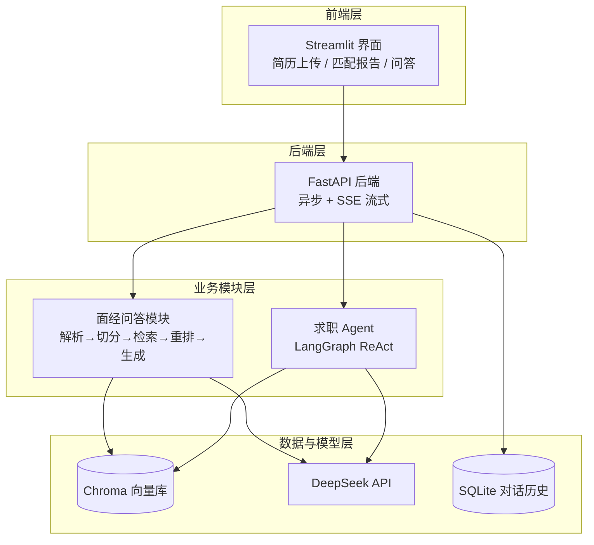

# AI 求职助手

基于大模型 API 的命令行 AI 助手，支持多轮对话与工具调用。
这是「AI 应用开发」学习路线的实战项目，将持续迭代为完整的 RAG + Agent 应用。

## 已实现功能

- **多轮对话**：基于 messages 历史维护上下文，模型能记住前文
- **工具调用（Function Calling）**：模型可自主调用计算器、当前时间查询等工具
- **上下文重置**：输入 `/reset` 一键清空对话历史
- **配置与代码分离**：API 密钥通过 .env 管理，不进入版本控制

## 快速开始

### 环境要求

- Python 3.12+
- DeepSeek API Key（申请地址：https://platform.deepseek.com ）

### 安装与运行

```bash
# 1. 克隆仓库
git clone https://github.com/612Hz/ai-job-assistant.git
cd ai-job-assistant

# 2. 创建并激活虚拟环境
python -m venv .venv
source .venv/bin/activate        # Windows 用: .venv\Scripts\activate

# 3. 安装依赖
pip install -r requirements.txt

# 4. 在项目根目录新建 .env 文件，写入：
#    DEEPSEEK_API_KEY=你的key
#    DEEPSEEK_BASE_URL=https://api.deepseek.com
#    LLM_MODEL=deepseek-flash

# 5. 运行
python main.py
```

## 项目结构

```
ai-job-assistant/
├── config.py          # 配置读取（从 .env 加载）
├── llm.py             # LLM 调用封装（chat / chat_with_tools）
├── tools.py           # 工具定义与实现（计算器、时间查询）
├── main.py            # 命令行交互入口
├── .env               # 密钥（不提交到仓库）
├── .gitignore
└── requirements.txt
```

## 技术栈

| 类别 | 选型 |
|---|---|
| 语言 | Python 3.12 |
| 模型 | DeepSeek API（OpenAI 兼容协议） |
| 依赖管理 | python-dotenv |

## 后续计划

- [x] 多轮对话 + 上下文管理
- [x] 工具调用（Function Calling）
- [ ] 流式输出
- [ ] 文档解析与切分
- [ ] 向量检索（RAG）
- [ ] LangGraph Agent 编排
- [ ] FastAPI + Streamlit 部署上线


## 系统架构

